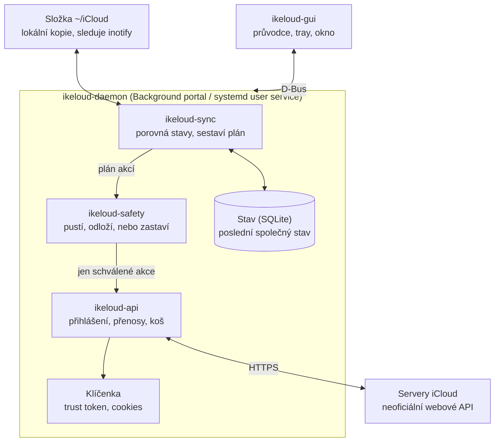

# ike loud – zadání a plán realizace

Stav k 14. 11. 2026 · Brbla

Tento soubor spojuje dva podklady: **Část 1: Zadání** (co se staví a jak se to má chovat) a **Část 2: Plán realizace** (milníky, brány, odhady). Diagram architektury je v části 1 jako Mermaid.

---

# Část 1: Zadání

## Cíl a pro koho

ike loud zpřístupní soubory z iCloud Drive na Linuxu jako běžnou složku v domácím adresáři, bez příkazové řádky. Apple oficiálního klienta pro Linux nevydává, takže lidé s placeným iCloudem dnes na Linuxu zůstávají u webu icloud.com.

- **Cílový uživatel:** laik, který má iPhone nebo Mac a na počítači Linux (Ubuntu, Fedora, Mint, CachyOS). Nezná rclone ani systemd.
- **Hlavní použití:** otevřít, upravit a uložit soubor z iCloud Drive stejně jako lokální soubor; změny se objeví na iPhonu a Macu.
- **Měřítko úspěchu:** žádný ztracený ani poškozený soubor na iCloudu; nastavení do 5 minut; aplikace běží týdny bez zásahu.

## Základní principy

Když si aplikace není jistá, nic nemění a zeptá se. Pomalá nebo nedokončená synchronizace je přijatelná, zničená data na iCloudu ne.

1. **Při pochybnosti rozhoduje iCloud.** Běžná úprava na Linuxu se normálně nahraje na iCloud. Jen když se soubor mezitím změnil i jinde, nebo si aplikace není jistá, zůstane na serveru jeho verze a lokální se uloží vedle jako konfliktní kopie. Nic se nezahodí.
2. **Nic se nepřepisuje naslepo.** Každý zápis na server ověří, že soubor je stále ve verzi, kterou aplikace zná (etag). Jinak vznikne konfliktní kopie.
3. **Mazání je vratné.** Smazání na Linuxu jde na iCloudu do „Nedávno smazané“, nikdy trvale.
4. **Hromadné změny mají brzdu.** Když by jeden běh smazal nebo přepsal víc než nastavený limit souborů, synchronizace se zastaví a čeká na potvrzení.
5. **Neúplná data se nikdy nenahrají.** Soubor se nahrává až po dokončení zápisu; stažení jde do dočasného souboru a ten se přejmenuje až po kontrole velikosti a kontrolního součtu.
6. **Každá akce je v deníku.** Uživatel vidí, co se kdy nahrálo, stáhlo a smazalo, a může ji vrátit obnovením z koše nebo z lokální historie.

Rozhodovací tabulka synchronizace (podle posledního společného stavu):

| Co se změnilo od poslední synchronizace | Co aplikace udělá |
| --- | --- |
| Jen soubor na Linuxu | Nahraje ho na iCloud |
| Jen soubor na iCloudu | Stáhne ho na Linux |
| Obojí | Na iCloudu zůstane jeho verze, lokální se uloží vedle jako konfliktní kopie |
| Nic | Nic |

## Uživatelský zážitek

Uživatel aplikaci nainstaluje, jednou se přihlásí a pak už jen používá složku **iCloud** v domovském adresáři.

**První spuštění (průvodce):**

1. Přihlášení Apple účtem: e-mail a heslo, s nabídkou „Zapamatovat heslo v klíčence“.
2. Dvoufázové ověření: kód z iPhonu nebo SMS, se srozumitelnou nápovědou.
3. Pokud má účet zapnutou pokročilou ochranu dat (ADP), průvodce vysvětlí, že na iPhonu musí povolit „Přístup k datům iCloudu na webu“ a potvrdit výzvu.
4. Výběr složek k synchronizaci. Výchozí je vše, pokud se to vejde na disk. Nevybrané složky na Linuxu nejsou; stahování při otevření přijde až později.
5. První běh jen stahuje. Zápis na iCloud se zapne až po dokončení a kontrole prvního stažení, bez dotazu na „režim“. Režim jen pro čtení jde kdykoli zapnout v nastavení.

**Každodenní používání:**

- Stav je vidět v okně aplikace a v oznámeních: synchronizováno, probíhá, čeká na potvrzení, chyba. Ikona v liště je doplněk tam, kde ji prostředí umí; GNOME ji ve výchozím stavu nemá.
- Oznámení jen tehdy, když je potřeba jednat: konflikt, vypršelé přihlášení, zastavená hromadná změna.
- Okno aplikace: stav, deník změn, konflikty k vyřešení, nastavení, tlačítko „Otevřít složku“.
- Opakované přihlášení (Apple dává důvěru zařízení obvykle na 30 dní): aplikace upozorní tři dny předem a synchronizace mezitím bezpečně stojí. S uloženým heslem stačí zadat kód, bez něj heslo a kód.
- Rozhraní česky a anglicky; texty bez technických pojmů.

## Funkce MVP a co je mimo rozsah

První verze umí jen iCloud Drive, ale pořádně.

| Funkce | MVP | Později | Mimo rozsah |
| --- | --- | --- | --- |
| Přihlášení s 2FA, uložení relace v klíčence | ano |  |  |
| Podpora účtů s ADP | ano |  |  |
| Režim jen pro čtení | ano |  |  |
| Obousměrná synchronizace vybraných složek | ano |  |  |
| Soubory na vyžádání (stáhnout při otevření) |  | ano |  |
| Konflikty, koš, brzda hromadných změn, deník | ano |  |  |
| Tray ikona, oznámení, okno stavu | ano |  |  |
| Integrace do správce souborů (ikony stavu v Nautilu, Dolphinu) |  | ano |  |
| Více Apple účtů |  | ano |  |
| iCloud Fotky (jen čtení, export) |  | ano |  |
| Sdílené složky jiných uživatelů |  | ano |  |
| Kalendář a kontakty |  |  | ano: řeší CalDAV/CardDAV v GNOME a KDE |
| Poznámky, Klíčenka, Najdi |  |  | ano |
| Windows a macOS |  |  | ano |

## Technická architektura v Rustu

Celé je to v Rustu: synchronizační démon jako uživatelská služba a oddělená GUI aplikace, která s ním mluví přes D-Bus. Když GUI spadne nebo se zavře, synchronizace běží dál a nic se nerozbije.

**Komponenty (Cargo workspace):**

- `ikeloud-api`: klient iCloud webových služeb. Přihlášení (SRP-6a, 2FA, trust token, ADP/PCS cookies), výpis složek, stahování, nahrávání, přesun do koše. Žádná synchronizační logika.
- `ikeloud-sync`: synchronizační engine. Porovná tři stavy (lokální, vzdálený, poslední společný) a vytvoří plán akcí. Plán projde bezpečnostní vrstvou, teprve pak se provádí.
- `ikeloud-safety`: pravidla z kapitoly Ochrana dat. Jediné místo, které smí pustit zápis na server.
- `ikeloud-daemon`: běží na pozadí (ve Flatpaku přes Background portal, v nativních balíčcích jako systemd user service). Lokální změny hlásí inotify jako nápovědu; pravdu dává pravidelný úplný průchod složkou. Serveru se ptá šetrně.
- `ikeloud-gui`: průvodce, okno stavu, tray ikona, oznámení.
- `ikeloud-cli`: diagnostika pro pokročilé a pro hlášení chyb.

**Diagram architektury** (na server zapisuje jen to, co pustí bezpečnostní vrstva):

Žádná cesta ze synchronizace na server nevede mimo ikeloud-safety; GUI s démonem mluví jen přes D-Bus.

**Knihovny (návrh):**

| Účel | Crate |
| --- | --- |
| Asynchronní běh, HTTP | `tokio`, `reqwest` s `rustls` |
| Přihlášení Apple | `srp`, `pbkdf2`, `sha2` |
| Stav synchronizace | `rusqlite` (SQLite v režimu WAL) |
| Hesla a tokeny | `keyring` (Secret Service: GNOME Keyring, KWallet; ve Flatpaku Secret portal) |
| Sledování souborů | `notify` |
| GUI | `gtk4` + `libadwaita` (vypadá nativně v GNOME, funguje i jinde) |
| Tray ikona | `ksni` (StatusNotifierItem) |
| IPC | `zbus` (D-Bus) |
| Soubory na vyžádání (později) | `fuser` (FUSE) |

**Odkud vzít znalost API:** oficiální dokumentace neexistuje. Vzorem jsou dvě udržované open-source implementace: backend `iclouddrive` v [rclone](https://rclone.org/iclouddrive/) (Go, od verze 1.69, podporuje i ADP) a [pyicloud](https://pypi.org/project/pyicloud/) (Python, poslední vydání říjen 2026). Obě jsou pod licencí MIT, takže port do Rustu je možný s uvedením autorů.

**Záložní plán:** pokud by vlastní klient v Rustu ve fázi 0 narazil, démon může jako transportní vrstvu použít přibalené rclone. Bezpečnostní vrstva, stav i GUI zůstanou v Rustu.

## Ochrana dat

Každá akce na serveru prochází bezpečnostní vrstvou, která ji může pustit, odložit, nebo zastavit a zeptat se uživatele.

| Situace | Co aplikace udělá |
| --- | --- |
| Soubor změněn na Linuxu i jinde od poslední synchronizace | Nepřepíše. Obě verze zůstanou, lokální jako „soubor (konflikt Linux 2026-11-13).ext“. Konflikt se ukáže v okně. |
| Smazání na Linuxu | Přesun do koše iCloudu (Nedávno smazané, 30 dní). Nikdy trvalé smazání. |
| Smazání na iCloudu | Lokální kopie jde do koše systému (freedesktop Trash), ne `rm`. |
| Jeden běh by smazal nebo přepsal víc než 50 souborů, nebo víc než 10 souborů a zároveň přes 10 % synchronizovaného obsahu | Pauza a dotaz s přehledem změn. Limit jde nastavit. |
| Lokální složka najednou chybí nebo je prázdná (odpojený disk, smazaný adresář) | Bere se jako chyba, ne jako „smazat vše“. Synchronizace stojí. |
| Server vrátí prázdný nebo podivný výpis | Bere se jako chyba API, ne jako smazaný obsah. Stav se nemění. |
| Soubor se právě zapisuje (editor, kopírování) | Nahrání až po ustálení (velikost a čas se nemění 5 s). |
| Přerušené nahrávání nebo stahování | Dočasný soubor se zahodí, akce se zopakuje. Nikdy se nepoužije neúplný soubor. |
| Vypršelé přihlášení, chyba 401/421, výpadek sítě | Vše stojí, lokální změny čekají ve frontě, uživatel dostane jedno oznámení. |
| Neznámá odpověď API (Apple něco změnil) | Bezpečný režim: jen čtení, dokud nepřijde opravená verze. |
| Názvy souborů nepovolené na iCloudu nebo lišící se jen velikostí písmen | Soubor se nenahraje, uživatel dostane vysvětlení. iCloud nerozlišuje velká a malá písmena, Linux ano. |

**Další pojistky:**

- Stav (SQLite) se zapisuje transakčně; po pádu démon pokračuje tam, kde skončil.
- Lokální historie je povinná: před každým přepsáním, lokálně i na serveru, se předchozí verze uloží stranou na 30 dní. Je to záchranná síť pro případ, že server zápis podmíněný verzí nevynucuje.
- Žádný zápis na server bez výsledku `ikeloud-safety`; dodržuje to typový systém (zápis vyžaduje schválený token akce).
- Heslo se ukládá jen tehdy, když to uživatel při přihlášení sám zaškrtne, a pouze do klíčenky systému. Jinak je v klíčence jen trust token a cookies relace.

**Pravidla pro názvy, přesuny a zvláštní soubory:**

- Přejmenování a přesun se provádí jako přejmenování a přesun (lokálně podle inode, na serveru podle ID dokumentu), nikdy jako smazání a nové nahrání.
- Názvy se porovnávají po Unicode normalizaci (NFC) a bez ohledu na velikost písmen. „Příloha“ uložená z Macu a z Linuxu je tentýž soubor.
- O konfliktu rozhoduje verze na serveru (etag) a obsah, nikdy čas změny; hodiny počítače mohou jít špatně.
- Konfliktní kopie je běžný nový soubor: nahraje se na iCloud, takže obě verze jsou vidět i na iPhonu.
- Dočasné a zamykací soubory (`.~lock.*#`, `*.swp`, `*.part`, `.DS_Store`), symbolické odkazy a speciální soubory se nesynchronizují.
- Existující neprázdná složka se při prvním nastavení nikdy tiše neslučuje; aplikace chce novou nebo prázdnou složku.
- Plné úložiště na iCloudu nebo plný disk: synchronizace stojí s jasnou zprávou, nic se nemaže.
- Odhlášení nebo odinstalace: lokální soubory zůstávají, mažou se jen tokeny.
- Síťový klient smí mluvit jen s doménami Applu z pevného seznamu; heslo nikdy neodchází jinam a hlídá to test.

**Vzdálená pojistka:** klient se jednou denně zeptá na podepsaný stavový soubor projektu. Když denní kanárek zjistí změnu API, soubor přepne všechny klienty do režimu jen pro čtení dřív, než zkusí zapisovat. Neodcházejí při tom žádná data uživatele a dotaz jde v nastavení vypnout.

## Rizika a omezení

Největší riziko je, že aplikace stojí na neoficiálním API, které může Apple kdykoli změnit.

| Riziko | Dopad | Opatření |
| --- | --- | --- |
| Apple změní webové API nebo přihlášení | Synchronizace přestane fungovat | Bezpečný režim při neznámé odpovědi; automatické kontroly proti testovacímu účtu každý den; rychlé vydávání oprav |
| Podmínky použití iCloudu | Apple neoficiální klienty nepodporuje | Jasně uvést, že nejde o produkt Apple; žádné logo Apple ani název „iCloud“ v názvu aplikace |
| Účty s ADP | Vyžadují zapnutý přístup z webu a potvrzení na zařízení | Průvodce krok za krokem; rclone ukazuje, že to jde |
| Trust token platí jen 30 dní | Uživatel se musí jednou za měsíc znovu přihlásit | Připomínka předem, pauza místo chyb |
| Omezování požadavků (rate limiting) | Zpomalení, dočasné zablokování | Exponenciální čekání, šetrné dotazování |
| Velké knihovny (desítky tisíc souborů) | Pomalé první načtení | Postupný výpis, ukazatel postupu, výběr složek |
| Balíčky dokumentů z Macu (Pages, Keynote) | Na serveru jsou to složky, ne soubory | MVP: synchronizovat jako složky a neměnit je; ověřit ve fázi 0 |

**Poznámka k názvu a ikoně:** název „ike loud“ zůstává (rozhodnuto 14. 11. 2026). Zní jako ochranná známka Applu a Flathub žádá, aby název ani ikona známky neporušovaly, takže riziko námitky trvá; záložní název je „loud ike“. Slovo „iCloud“ se proto objeví jen v popisu („neoficiální klient pro iCloud Drive“). Ikona bude vlastní návrh (například zpívající mráček), ne fotografie skutečné osoby ani prvky značky Apple.

## Testování, distribuce a fáze vývoje

Na skutečných datech se testuje až po týdnech provozu na testovacím účtu.

**Pravidlo: každá funkce má testy vstupu a výstupu.** Kód bez testů se do hlavní větve nedostane.

- Každá funkce má testy, které říkají, co jde dovnitř a co má vyjít ven, včetně okrajových případů: prázdný vstup, velké soubory, diakritika a nepovolené znaky v názvech.
- Každá funkce, která může selhat, vrací `Result` s konkrétním typem chyby. Test ověří, že pro chybný vstup vrátí přesně tu chybu, kterou má, ne jen „nějakou chybu“.
- Pro každé pravidlo z kapitoly Ochrana dat existuje test, že nebezpečná akce byla zastavena.
- Testy jsou tabulkové (vstup → očekávaný výstup), aby šly snadno doplňovat.
- V produkčním kódu žádné `unwrap()`, `expect()` ani `panic!`; hlídá to `clippy`.
- CI při každé změně: `cargo test`, `cargo clippy -D warnings`, pokrytí (`cargo llvm-cov`, minimum 90 % u `ikeloud-safety` a `ikeloud-sync`) a mutation testing (`cargo-mutants`) u bezpečnostní vrstvy. Ten ověří, že testy opravdu chytí změnu chování.

Příklad pro funkci bezpečnostní vrstvy, která posuzuje plán akcí:

| Vstup | Očekávaný výstup |
| --- | --- |
| Plán: nahrát 1 soubor, etag na serveru sedí | `Ok(Schváleno)` |
| Plán: nahrát 1 soubor, etag na serveru se změnil | `Err(Konflikt)` |
| Plán: smazat 120 z 200 souborů | `Err(HromadnaZmenaCekaNaPotvrzeni)` |
| Plán: smazat vše, lokální složka chybí | `Err(LokalniSlozkaNedostupna)` |
| Prázdný plán | `Ok(NicKProvedeni)` |

**Formální ověření:** synchronizační algoritmus se ověří dřív, než se napíše, a bezpečnostní vrstva se ověřuje přímo v Rust kódu.

| Nástroj | Co ověřuje | Kdy |
| --- | --- | --- |
| TLA+ (model checker TLC) | Model protokolu: tři stavy, souběžné změny na obou stranách, výpadky, pády. Invarianty: žádný obsah nezmizí bez koše nebo konfliktní kopie; po ustálení se obě strany shodují. | Fáze 0, před psaním enginu; model se aktualizuje s každou změnou algoritmu |
| Kani (model checker pro Rust) | Kritické funkce `ikeloud-safety` a sestavení plánu: pro všechny vstupy do dané velikosti platí například „plán s mazáním nad limitem nikdy nedostane schválení“. | Každá změna v CI |
| Deterministická simulace | Celý engine proti falešnému serveru s řízeným časem a náhodnými poruchami; selhání jde přehrát ze seedu. Inspirace: Dropbox Nucleus. | Každá změna v CI (tisíce scénářů), noční běh (statisíce) |

Plný důkaz (Lean, Verus, Creusot nebo Aeneas) je volitelný a jen pro funkci, která ze tří stavů sestavuje plán akcí. Rozhodnutí padne po fázi 2 podle toho, co odhalí TLA+ a simulace.

**Cizí kód:** pro knihovny, převzatý kód i přibalené programy platí stejná pravidla jako pro vlastní kód. Žádná aktualizace nesmí změnit chování aplikace, aniž by selhal test.

- **Obal pro každou knihovnu.** Aplikace volá cizí kód jen přes vlastní tenký modul. Zbytek kódu knihovnu přímo nevidí a hlídá to pravidlo v CI.
- **Testy smlouvy.** Každá cizí funkce, kterou obal používá, má tabulku vstupů a očekávaných výstupů včetně okrajových a chybových případů. Změna výstupu (nula místo prázdné hodnoty, jiný znak, jiná chyba) shodí CI.
- **Přesně připnuté verze.** `Cargo.lock` je v repozitáři, verze jsou zapsané přesně (`=1.2.3`) a sestavuje se s `--locked`. Zdrojové kódy závislostí jsou uložené u projektu (`cargo vendor`), takže se vždy sestavuje ze stejného kódu.
- **Aktualizace jen záměrně.** Vždy jedna knihovna na jednu změnu, s přečteným rozdílem kódu, záznamem v `cargo vet` a všemi testy včetně simulace. Automatické aktualizace se nepouštějí.
- **Kontroly v CI.** `cargo deny` (licence, zdroje, zakázané a duplicitní knihovny) a `cargo audit` (známé zranitelnosti).
- **Co nejméně závislostí.** Výchozí funkce knihoven jsou vypnuté a každá nová knihovna potřebuje zdůvodnění. `ikeloud-safety` nepoužívá nic kromě standardní knihovny.
- **Převzatý kód** z rclone nebo pyicloud se po portu do Rustu stává vlastním kódem se všemi testy. Záložní rclone by bylo připnuté na verzi s kontrolním součtem a mělo by vlastní testy smlouvy.
- **Systémové knihovny.** SQLite je přibalená v pevné verzi. GTK přichází z prostředí Flatpaku v připnuté verzi a neleží na cestě k datům.
- **Server Applu** je také cizí kód: denní kanárek je test smlouvy pro jeho odpovědi.

Změnu typu zachytí Rust už při překladu. Změnu hodnoty při stejném typu zachytí testy smlouvy.

**Testování:**

- Samostatný testovací Apple účet s iCloud Drive pro všechny integrační testy; nikdy ne účet vývojáře.
- Simulátor serveru (fake `ikeloud-api`) pro testy engine: konflikty, výpadky, prázdné výpisy, přerušené přenosy.
- Property-based testy (`proptest`): náhodné sekvence změn na obou stranách; tvrzení, že žádný obsah nezmizí bez záznamu v koši nebo konfliktu.
- Testy pádu: zabít démona v náhodném okamžiku a ověřit konzistenci po restartu.
- Kontrolní běh na pozadí: porovnání kontrolních součtů lokálně a na serveru, hlášení rozdílů.

**Distribuce:**

- Flatpak na Flathubu jako hlavní kanál (jedna instalace pro všechny distribuce).
- AppImage a balíčky .deb a .rpm z GitHub Releases.
- AUR pro Arch a CachyOS.
- Open source (MIT nebo Apache-2.0), aby kódu důvěřovali i lidé, kteří mu svěřují Apple účet.

**Fáze (přehled; závazné členění je v části 2, Milníky):**

1. **Fáze 0, ověření:** přihlášení vlastním Rust klientem (SRP, 2FA, ADP), výpis, stažení, nahrání a přesun do koše na testovacím účtu. Rozhodne, zda vlastní klient, nebo záložní rclone. Současně vznikne TLA+ model synchronizace, který musí projít před začátkem fáze 2.
2. **Fáze 1, jen čtení:** démon a GUI, které iCloud pouze stahují do lokální složky. Na server se nezapisuje nic.
3. **Fáze 2, obousměrná synchronizace:** bezpečnostní vrstva, konflikty, brzda, deník. Uzavřená beta s několika uživateli.
4. **Fáze 3, veřejné vydání 1.0:** Flathub, česká a anglická lokalizace, dokumentace pro laiky.
5. **Fáze 4, rozšíření:** soubory na vyžádání (FUSE), integrace do správců souborů, Fotky jen pro čtení.

## Zdroje

- [rclone: iCloud Drive backend](https://rclone.org/iclouddrive/)
- [pyicloud na PyPI](https://pypi.org/project/pyicloud/2026.10.1/)
- [icloud-linux (FUSE mount v Pythonu)](https://github.com/Bougakov/icloud-linux)

---

# Část 2: Plán realizace

Zadání je dobrý základ a tři úvodní rozhodnutí už padla. Zbývá milník 0, který ověří, co neoficiální API opravdu umí. Plán má šest milníků; každý končí měřitelnou bránou a bez jejího splnění se nepokračuje. Na iCloud se poprvé zapisuje až v milníku 3, po tom, co synchronizační jádro projde simulací.

Odhady počítají s jedním vývojářem na zhruba poloviční úvazek, který pracuje s kódovacími agenty. Jsou to odhady, ne závazky; nejvíc je může posunout milník 0.

## Co revize zadání našla

Tyto věci jsou už opravené přímo v zadání (část 1):

- **Průvodce bez technické volby.** Volba „jen čtení, nebo plná synchronizace“ zmizela. První běh vždy jen stahuje a zápis se zapne až po kontrole prvního stažení.
- **Rozpor s MVP.** Průvodce sliboval stahování při otevření, které je až po vydání. V první verzi se vybírají složky k synchronizaci.
- **GNOME nemá lištu s ikonami.** Stav musí být vidět v okně a v oznámeních; ikona v liště je jen doplněk.
- **Brzda hromadných změn** by se u malých složek spouštěla pořád. Práh je nově 50 souborů, nebo 10 souborů a zároveň 10 % obsahu.
- **Chyběla pravidla** pro přejmenování a přesuny, českou diakritiku v názvech, dočasné soubory, plné úložiště a odhlášení.
- **Lokální historie je povinná,** ne volitelná. Je to jediná jistá cesta zpět, pokud server nevynucuje zápis podmíněný verzí.
- **Flatpak:** démon běží přes Background portal a tokeny jdou přes Secret portal.

## Tři rozhodnutí (14. 11. 2026)

| Rozhodnutí | Výsledek | Co z toho plyne |
| --- | --- | --- |
| Heslo k Apple účtu | Nabídnout uložení do klíčenky při přihlášení | S uloženým heslem stačí po 30 dnech zadat kód; bez něj heslo a kód. |
| Název | „ike loud“ zůstává | Riziko námitky Applu nebo Flathubu trvá. Slovo „iCloud“ jen v popisu a vlastní ikona. Záložní název je „loud ike“; technické identifikátory (ikeloud) se při přejmenování nemění. Kdyby Flathub odmítl i tak, zůstávají AppImage, .deb, .rpm a AUR. |
| Vzdálená pojistka | Ano | Denní dotaz na podepsaný stavový soubor, vypínatelný v nastavení. |

## Laťka kvality

Produkt je složka, ne aplikace: uživatel má na ike loud zapomenout. Body níže jsou výstupní kritéria milníků, ne přání.

- **Jedna věc, dotažená.** Jen iCloud Drive. Všechno ostatní je „ne“, dokud není venku verze 1.0.
- **Tři obrazovky do první složky:** přihlášení, kód, výběr složek. Žádná volba, které laik nerozumí.
- **Žádná technická chybová hláška.** Každá zpráva říká, co se stalo, že jsou soubory v bezpečí, a nabízí jedno tlačítko.
- **Ticho.** Oznámení jen tehdy, když musí uživatel něco udělat.
- **Lehkost.** V klidu pod 1 % procesoru a pod 60 MB paměti; první soubor ve složce do minuty po přihlášení.
- **Detaily.** Vlastní ikona, čeština psaná člověkem, přístupnost pro čtečky obrazovky, tmavý režim.

## Co musí zjistit milník 0

Odpovědi rozhodnou o architektuře. Veřejná dokumentace neexistuje, takže se zjišťují pokusem na testovacím účtu.

| Otázka | Když je odpověď „ne“ |
| --- | --- |
| Vynucuje server zápis podmíněný verzí (etag)? | Kontrola těsně před zápisem a po něm, povinná lokální historie. Okno pro souběh zůstane a musí být v TLA+ modelu. |
| Vrací server kontrolní součet souboru? | Ověření podle velikosti a zpětného stažení vzorku; kontrolní běh bude pomalejší. |
| Jde levně zjistit, co se změnilo (mění se etag složky se změnou uvnitř)? | Úplný průchod stromem s omezenou frekvencí; u velkých knihoven zpoždění v minutách. |
| Zachová přejmenování a přesun ID dokumentu? | Přesun jako kopie a koš; brzda musí počítat přesuny zvlášť. |
| Jde položku z „Nedávno smazané“ obnovit? | Mazání na serveru se v první verzi vypne nebo si vyžádá potvrzení. |
| Kolik dotazů snese účet bez omezování? | Určí interval dotazování a rychlost prvního stažení. |
| Projde přihlášení s ADP vlastním klientem v Rustu? | Záložní plán: rclone jako transportní vrstva. |

## Milníky

Do verze 1.0 je to zhruba 8 až 9 měsíců. Pořadí se oproti fázím v zadání liší v jednom: synchronizační jádro se nejdřív dokončí proti falešnému serveru a teprve potom smí zapisovat na skutečný iCloud.

| Milník | Výsledek | Odhad |
| --- | --- | --- |
| 0. Průzkum a model | Odpovědi na otázky výše, TLA+ model, rozhodnutí o klientovi | 4–5 týdnů |
| 1. Jen čtení | Aplikace, která iCloud bezpečně stahuje | 6–8 týdnů |
| 2. Jádro v simulaci | Synchronizace a bezpečnostní vrstva hotové proti falešnému serveru | 6–8 týdnů |
| 3. Zápis a uzavřená beta | Obousměrná synchronizace u 5–10 lidí | 6 týdnů práce + 6 týdnů provozu |
| 4. Vydání 1.0 | Flathub, balíčky, nápověda, web | 4–6 týdnů |
| 5. Po vydání | Soubory na vyžádání, správci souborů, Fotky | průběžně |

### Milník 0: průzkum a model

- Testovací Apple účet, repozitář, Cargo workspace a CI od prvního dne (testy, clippy, pokrytí, připnuté závislosti, cargo deny a cargo vet).
- Prototyp `ikeloud-api`: přihlášení (SRP, 2FA, ADP), výpis, stažení, nahrání, přejmenování, koš.
- Pokusy k otázkám z předchozí kapitoly; každý výsledek zapsaný jako rozhodnutí v repozitáři.
- TLA+ model synchronizace včetně souběhu, který API nedokáže vyloučit.
- Návrh tří obrazovek průvodce a ikony.

**Brána:** všechny otázky mají odpověď z pokusu, ne z odhadu. TLA+ model projde bez porušení invariantů. Je rozhodnuto mezi vlastním klientem a rclone.

### Milník 1: jen čtení

- Produkční `ikeloud-api`: typované chyby, opakování, omezení rychlosti, pevný seznam domén.
- Stav v SQLite, stahování do dočasných souborů, obnova po pádu.
- Démon, D-Bus rozhraní a GUI: průvodce, okno stavu, oznámení, opětovné přihlášení.
- Flatpak balíček hned, aby sandbox nepřekvapil na konci.
- Denní kanárek: automatická kontrola proti testovacímu účtu.

**Brána:** 14 dní běhu na testovacím účtu bez zásahu. Strom s 20 000 soubory stažený a ověřený. Zabití démona v 1 000 náhodných okamžicích nepoškodí stav. Pět laiků projde instalací a průvodcem do 5 minut bez pomoci. V síťovém záznamu není jediný požadavek na zápis.

### Milník 2: jádro v simulaci

- Falešný server s řízeným časem a poruchami.
- `ikeloud-sync`: plán ze tří stavů, přesuny, konflikty, normalizace názvů.
- `ikeloud-safety`: pravidla z kapitoly Ochrana dat a schvalovací token v typovém systému.
- Tabulkové testy, proptest, Kani, mutation testing a deterministická simulace.

**Brána:** milion simulovaných scénářů bez ztráty obsahu. Pokrytí aspoň 90 %. V `ikeloud-safety` nepřežije žádný mutant bez zdůvodněné výjimky. Kani ověří brzdu a schvalování. Každé pravidlo z Ochrany dat má test, že nebezpečnou akci zastaví.

### Milník 3: zápis a uzavřená beta

- Zápis proti testovacímu účtu: nahrání, přepsání, přesun, koš.
- Deník změn, obrazovka konfliktů, potvrzení hromadné změny, lokální historie.
- Kontrolní běh na pozadí a vzdálená pojistka.
- Beta: nejdřív vlastní kopie dat, potom 5–10 pozvaných lidí, kteří mají zálohu.

**Brána:** 30 dní zápisů na testovacím účtu bez neshody v kontrolním běhu. Šest týdnů bety bez jediného ztraceného nebo poškozeného souboru. Každý nahlášený problém má test, který ho reprodukuje. Cvičná změna API přepne klienty do režimu jen pro čtení.

### Milník 4: vydání 1.0

- Flathub, AppImage, .deb, .rpm a AUR.
- Čeština a angličtina; nápověda pro laiky a stránka „Co dělat, když…“.
- Web, který na první pohled říká, že nejde o produkt Applu.
- Postup pro rychlou opravu: od rozbitého API k vydání do 48 hodin.
- Revize kódu, který pracuje s heslem, někým druhým.

**Brána:** test použitelnosti s pěti novými laiky. Žádná známá chyba s rizikem pro data. Opravné vydání vyzkoušené nanečisto.

### Milník 5: po vydání

Soubory na vyžádání (FUSE), integrace do Nautilu a Dolphinu, Fotky jen pro čtení a více účtů. Každé rozšíření přijde až tehdy, když provoz verze 1.0 ukáže stabilitu.

## Jak se bude pracovat

- Nejdřív tabulka testů, potom kód. Zadání pro kódovacího agenta je tabulka vstupů a očekávaných výstupů.
- `ikeloud-safety` čte člověk řádek po řádku; proto je záměrně malá.
- Změna chování začíná změnou zadání a TLA+ modelu, ne kódu.
- Hlavní větev je vždy vydatelná; od milníku 1 vychází sestavení každé dva týdny.

Cizí kód se volá jen přes vlastní obal s testy smlouvy. Aktualizace knihoven jsou záměrné, po jedné a s přečteným rozdílem; podrobnosti jsou v části 1 v kapitole o testování.

## Největší rizika plánu

| Riziko | Co s ním |
| --- | --- |
| Apple změní nebo zablokuje přihlášení | Kanárek, vzdálená pojistka, záložní rclone. Otevřeně říkat, že klient je neoficiální. |
| Server nevynucuje podmíněný zápis | Lokální historie, kontrola před zápisem a po něm, souběh v modelu. |
| Námitka k názvu | Název zůstává. Vlastní ikona a „iCloud“ jen v popisu; při námitce přejmenování na „loud ike“, případně distribuce mimo Flathub. |
| Jeden vývojář | Malý rozsah verze 1.0, automatizované vydávání, open source od prvního dne. |

## První týden

- [x] Rozhodnout tři otázky z úvodu.
- [ ] Založit testovací Apple účet s dvoufázovým ověřením a zjistit, zda na něm půjde zapnout ADP.
- [ ] Založit repozitář, Cargo workspace a CI.
- [ ] Zaznamenat v prohlížeči přihlášení a práci s Drive na icloud.com a porovnat s kódem rclone a pyicloud.
- [ ] První průchod v Rustu: přihlášení a výpis kořenové složky.
- [ ] Kostra TLA+ modelu se třemi stavy.

## Zdroje

- [Flathub: požadavky na aplikace](https://docs.flathub.org/docs/for-app-authors/metainfo-guidelines/quality-guidelines)
- [rclone: iCloud Drive backend](https://rclone.org/iclouddrive/)
